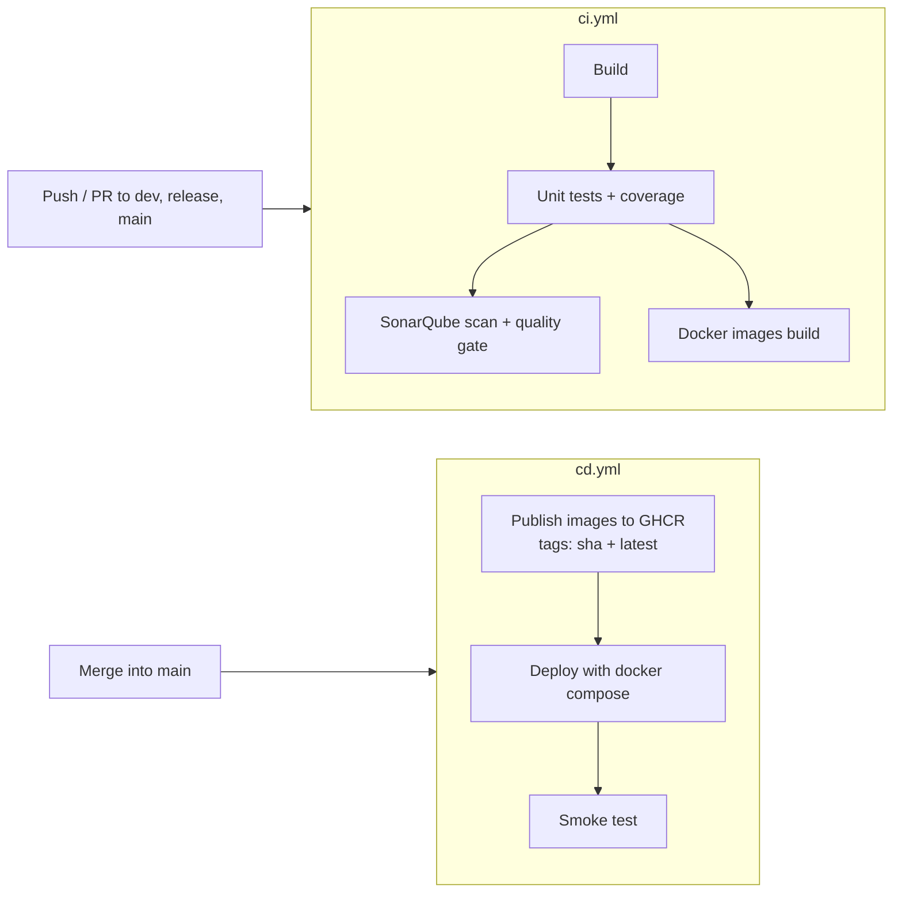

# CI/CD and code quality

Both repositories (`back-itinerary` and `front-intinerary`) use the same
pipeline shape with GitHub Actions.



## CI — `.github/workflows/ci.yml`

Runs on every push to `dev`, `release` and `main`, and on every pull request into them.

| Job | What it checks |
|---|---|
| Build & unit tests | `npm ci`, builds the three services, `npm run test:cov` (Jest + lcov) |
| SonarQube analysis | Sends code + coverage to SonarQube and fails if the quality gate fails |
| Docker images build | The three Dockerfiles still build |

The SonarQube job only runs once the repository has the secrets
`SONAR_HOST_URL` and `SONAR_TOKEN` (Settings → Secrets and variables → Actions).
Without them it prints a notice and is skipped, so CI stays green.

> GitHub's runners can't reach `localhost:9000`. For the CI job, use a
> SonarQube server reachable from the internet, or SonarCloud (free for public
> repositories: `SONAR_HOST_URL=https://sonarcloud.io` and add
> `sonar.organization=<org>` to `sonar-project.properties`).

## CD — `.github/workflows/cd.yml` (continuous deployment example)

Runs on every merge into `main` (or manually from the Actions tab).

1. **Publish**: builds the three images and pushes them to GitHub Container
   Registry as `ghcr.io/canartovi97/<service>:<git sha>` and `:latest`.
2. **Deploy**: starts the stack with the images just published —
   `docker compose -f docker-compose.yml -f docker-compose.cd.yml up -d --no-build`.
   The itinerary container applies pending migrations before starting, so an
   empty database is ready on the first deploy.
3. **Smoke test**: [`scripts/smoke-test.sh`](../scripts/smoke-test.sh) waits for the
   three services and checks register → login → `/itineraries` (401 without token,
   200 with it). A failure fails the deployment and prints the container logs.

The deploy target is the runner itself (an ephemeral environment that is torn
down at the end), so the example works without a paid server. To deploy to a
real host, replace the deploy steps with an SSH step that runs the same
`docker compose ... pull && up -d` there.

## SonarQube locally

```bash
docker compose -f docker-compose.sonar.yml up -d   # http://localhost:9000, first login admin / admin
npm run test:cov                                   # generates apps/*/coverage/lcov.info
SONAR_TOKEN=<token> npm run sonar                  # token: My Account > Security > Generate
```

`npm run sonar` runs the scanner from its Docker image
([`scripts/sonar.js`](../scripts/sonar.js)), so nothing has to be installed.
The front-end has the same `npm run sonar` (after `npm run test:ci`) and
reports to the same server as the `front-intinerary` project.

Results on 2026-11-25 (local server, default "Sonar way" quality gate):

| Project | Quality gate | Bugs | Vulnerabilities | Code smells | Coverage | Duplication |
|---|---|---|---|---|---|---|
| back-itinerary | ✅ Passed | 0 (A) | 0 (A) | 8 (A) | 72.6 % | 2.5 % |
| front-intinerary | ✅ Passed | 0 (A) | 0 (A) | 6 (A) | 28.0 % | 0.9 % |

## Running the published images

```bash
IMAGE_TAG=latest docker compose -f docker-compose.yml -f docker-compose.cd.yml pull
IMAGE_TAG=latest docker compose -f docker-compose.yml -f docker-compose.cd.yml up -d --no-build
sh scripts/smoke-test.sh
```
